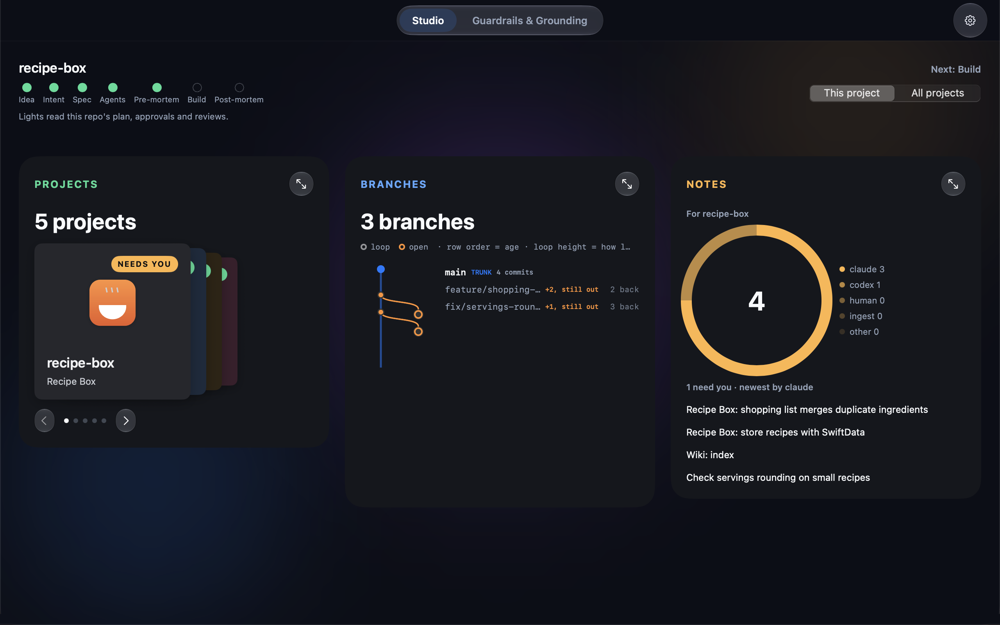
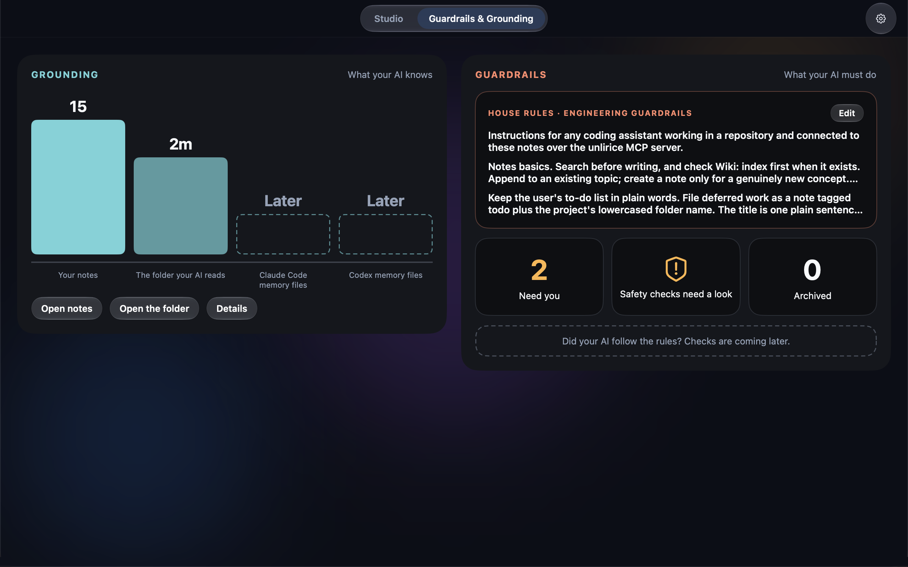
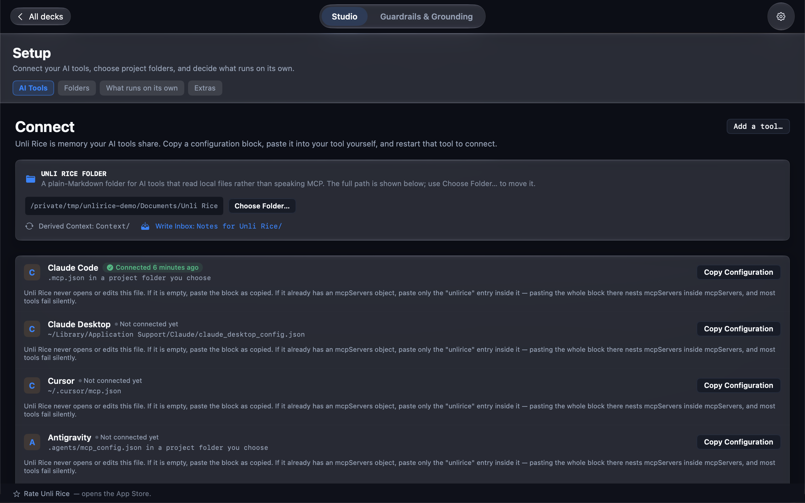

# Unli Rice

A persistent memory layer for autonomous LLM agents (Claude, Gemini, ChatGPT,
Kimi, coding assistants, local daemons), exposed over MCP. Multiple agents can
read and write into the same notes concurrently; every change is recorded as
an immutable event, and nothing is ever destructively deleted by an agent.

**[Read the User Guide](https://calmdownoscar.com/unlirice/user_guide.html)** — how to connect each AI tool (and how to paste the MCP config without breaking it), what can and cannot delete your notes, and what every pane actually does. It is audited against the code rather than written from memory.

See [PROJECT_NOTES.md](PROJECT_NOTES.md) for architecture, current status, and what's deferred — read that first before making changes.

Everything runs on-device, and the package has **no external dependencies** —
no bundled model, analytics, cloud service, or credentials. The optional
embedding connection is restricted to localhost. The reasoning that lives in
the system comes from whatever agent you connect over MCP.

## Documentation

- **[User Guide](https://calmdownoscar.com/unlirice/user_guide.html)** — the full guide, on the web: connecting each tool, pasting MCP config correctly, the three note layers, what can and cannot delete, troubleshooting, and a tool reference.
- **[Setup & User Guide](docs/USER_GUIDE.md)** — the in-repo version: step-by-step setup, connecting AI tools, Profile Builder, multi-vault profiles, and Mirror Export.
- **[Starter Templates](docs/TEMPLATES.md)** — Built-in Profile Builder templates and custom template format.
- **[Architecture & Project Notes](PROJECT_NOTES.md)** — Core design principles, append-only log architecture, and technical record.

## Screenshots

**Studio.** Your projects as a stack of cards. Each card shows the project's icon and whether it needs you; seven lights show how far its plan has come, from Idea to Post-mortem; and the Branches and Notes decks follow the project in front.



**Guardrails & Grounding.** What your AI knows (your notes and the folder it can read) beside the rules it follows (your House Rules), and what is waiting on your decision.



**Setup › AI Tools.** One row per tool, each showing the config file its block goes in, a Copy Configuration button, and when that tool last checked in. Unli Rice never opens or edits those files — you paste the block yourself. The path at the top is the folder route for tools that read local files rather than speaking MCP.



More, including the iPhone capture app, in [`Screenshots/`](Screenshots/).

## Quick start

Download from the **[Mac App Store](https://apps.apple.com/app/unli-rice/id6792837485)**.

The App Store can lag behind GitHub while a new version is in review. To run the newest version now, build it from the [latest release](https://github.com/CalixOscar/unli-rice/releases/latest). You need a Mac with Xcode installed:

```sh
git clone --branch v1.5 https://github.com/CalixOscar/unli-rice.git
cd unli-rice
./Scripts/make-app.sh         # builds dist/Unli Rice.app — then just open it
```

A build made this way is signed only for your own Mac. Don't run it alongside the App Store copy: quit one before opening the other.

Or from source:

```sh
swift build
swift test

swift run unlirice-mcp        # the MCP stdio server
swift run UnliRiceApp         # the GUI
swift run unlirice-agent      # one unattended maintenance tick, then exits
swift run janitor-calibrate   # dry-run the janitor's thresholds, writes nothing
```

For a Mac App Store archive, run `xcodegen generate` and open
`UnliRice.xcodeproj`. See [APP_STORE_SUBMISSION.md](APP_STORE_SUBMISSION.md) for
the signing, privacy, metadata, and review checklist. `project.yml` is the
source of truth for the generated project.

## Running itself

The app is meant to be ignorable. The **Keep working with the window closed**
toggle (Setup › What runs on its own) registers its bundled LaunchAgent so
ingestion and the janitor keep running after the window closes; anything that
needs a human decision waits in the notification centre instead of
interrupting, and **Your year so far** (an extra you can turn on in
Setup › Extras) reads a month or a year back to you from notes you already
have. Nothing that runs unattended can do more than the buttons can — the
janitor may only tag and flag, ingest may only create and append, and there
is no delete anywhere in the codebase.

## Ongoing development

Unli Rice is an actively maintained, evolving open-source project. Development
uses AI-assisted workflows and continues through new features, bug fixes,
testing, and improvements informed by practical use.

See [PROJECT_NOTES.md](PROJECT_NOTES.md) for the technical record, current
status, and planned work. Issues and pull requests are welcome.

## How this got built

Built with AI-assisted development using a multi-agent method: one model plans,
a different one tries to break the plan, and every build is checked against the
actual `git diff` and a real test run, never a tool's own report of success. The
method is written up at [calmdownoscar.com/how_I_work](https://www.calmdownoscar.com/how_I_work/).
It is one of seven apps I have published on the App Store, alongside the OpenGrail
web atlas. Backend and systems work is where I most want experienced eyes.

## Privacy

Unli Rice is local-first and does not collect user data. See the
[Privacy Policy](PRIVACY.md).

## License

MIT — see [LICENSE](LICENSE).
